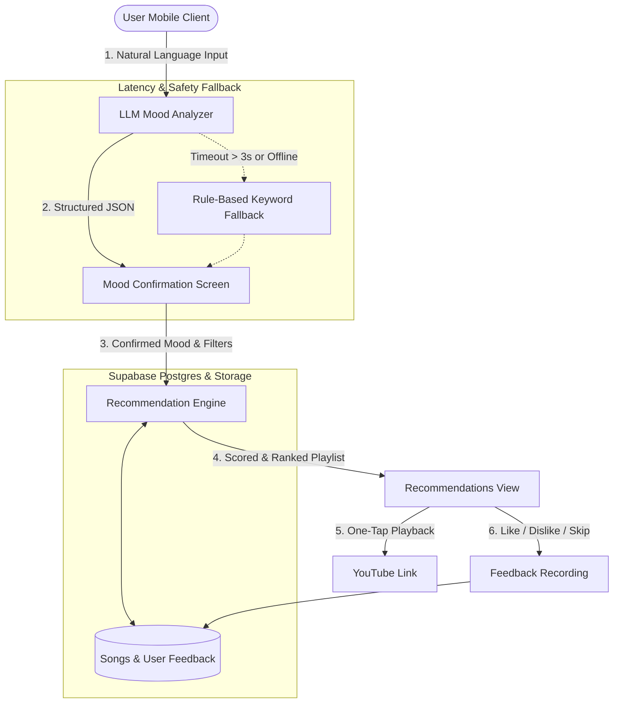
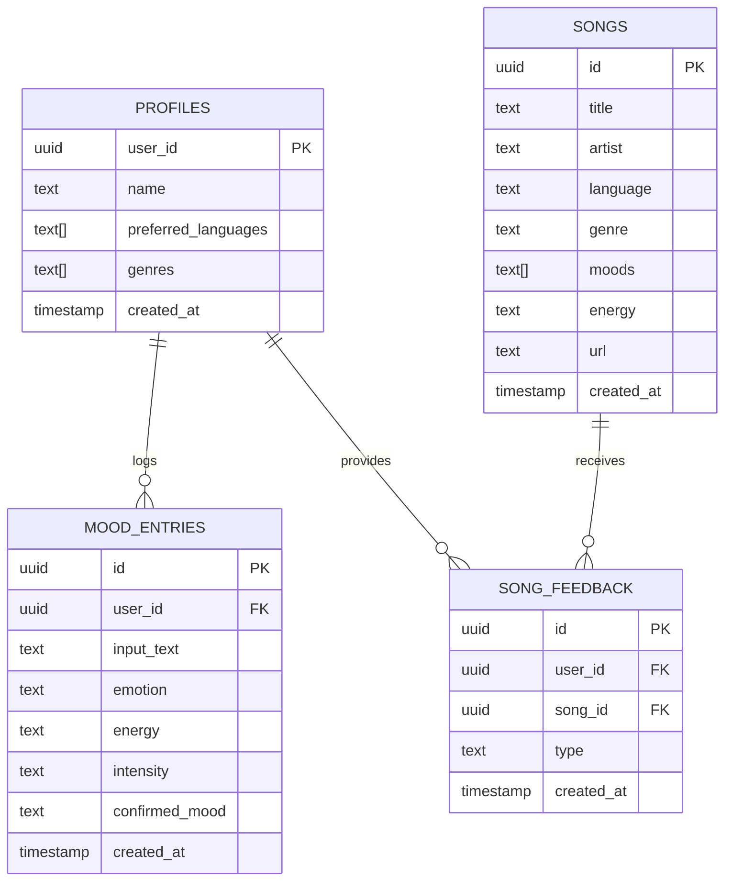

# Moodify

> **Feel it. Express it. Play it.**  
> *Transform free-text emotions into personalized music playlists in under 10 seconds.*

[](https://opensource.org/licenses/MIT)
[](https://nodejs.org/)
[](https://expo.dev/)
[](https://supabase.com/)

---

## Table of Contents

- [1. Executive Summary](#1-executive-summary)
- [2. System Architecture & Flow](#2-system-architecture--flow)
- [3. Multilingual AI & Mood Taxonomy](#3-multilingual-ai--mood-taxonomy)
- [4. Recommendation Engine & Scoring](#4-recommendation-engine--scoring)
- [5. Database Schema & Data Models](#5-database-schema--data-models)
- [6. API Contract](#6-api-contract)
- [7. Mobile Screen Hierarchy](#7-mobile-screen-hierarchy)
- [8. Repository Directory Structure](#8-repository-directory-structure)
- [9. Getting Started & Installation](#9-getting-started--installation)
- [10. 2-Day MVP Development Tracker](#10-2-day-mvp-development-tracker)
- [11. Success Criteria & Metrics](#11-success-criteria--metrics)

---

## 1. Executive Summary

### The Problem
Traditional music streaming platforms rely on rigid genre classifications or generic mood playlists. Users must browse extensively or select pre-defined emotion tags that fail to capture nuanced feelings, personal language blends, or recent feedback.

### The Solution
**Moodify** accepts unrestricted, conversational natural language in **English, Hindi (Devanagari), or Romanised Hinglish** (e.g., *"aaj office me bohot burnout ho gaya, need something chill"*). It extracts emotional intent, allows immediate confirmation, and matches the user with a curated, ranked catalog of Hindi and English tracks in under 10 seconds.

---

## 2. System Architecture & Flow



---

## 3. Multilingual AI & Mood Taxonomy

### Supported Mood Categories
Moodify categorizes input into 8 foundational mood categories:

| Mood | Emoji | Target Energy | Typical User Contexts |
| :--- | :---: | :---: | :--- |
| **Happy** | 😊 | High | Celebrations, energetic mornings, dance, excitement |
| **Sad** | 🌧️ | Low | Heartbreak, lonely evenings, contemplation, grief |
| **Angry** | 🔥 | High | Frustration, venting, workout intensity, rebellion |
| **Stressed** | 🤯 | Medium / Low | Work pressure, exam anxiety, overwhelm |
| **Relaxed** | 🌿 | Low | Unwinding, post-work chilling, studying, sleep |
| **Motivated** | ⚡ | High | Gym workouts, studying, ambitious hustle, running |
| **Romantic** | 💖 | Low / Medium | Late night chats, dates, soft acoustic, daydreaming |
| **Nostalgic** | 📻 | Medium / Low | Childhood memories, old school classics, retrospection |

### Multilingual Prompting & JSON Output
Mood inputs are processed into structured JSON representations:

```json
{
  "emotion": "exhaustion",
  "energy": "low",
  "intensity": "high",
  "context": "work",
  "targetMoods": ["Relaxed", "Stressed"],
  "source": "llm"
}
```

*Note: Keyword rules act as instantaneous fallbacks when LLM network latencies exceed 3 seconds. The fallback returns the same shape with `"source": "keyword"`.*

---

## 4. Recommendation Engine & Scoring

Recommendations are calculated dynamically using a multi-factor weighting formula:

$$\text{Score}(s) = (w_1 \cdot \text{MoodMatch}) + (w_2 \cdot \text{LanguageMatch}) + (w_3 \cdot \text{FeedbackBoost})$$

### Default Weights
- **$w_1 = 0.5$ (Mood Alignment):** Checks overlap between song's tagged moods and target mood.
- **$w_2 = 0.3$ (Language Match):** Matches user profile preferred languages (`Hindi`, `English`, or both).
- **$w_3 = 0.2$ (Feedback Boost):** Boosts tracks from artists or genres the user has marked with `like`.

### Negative Filtering & Fail-safes
- **Strict Dislike Exclusion:** Any song marked as `dislike` is filtered out immediately ($\text{Score} = -\infty$).
- **Fallback Reservoir:** If external services or database queries fail, a local 20-track fail-safe pool is delivered so the user never encounters a blank screen or crash.

---

## 5. Database Schema & Data Models



---

## 6. API Contract

This section is the single source of truth for the API. The TypeScript types for every request and response live in [`mobile/src/types/index.ts`](mobile/src/types/index.ts). To change anything here, agree in the group first.

Base path: `/api`  
Auth: every endpoint needs `Authorization: Bearer <Supabase access token>`.

### 6.1 Naming and allowed values

All JSON keys are **camelCase** in every request and response. The database keeps snake_case; the backend converts between the two only in `backend/src/utils/mappers.js`.

| Field | Allowed values |
| :--- | :--- |
| Mood (`confirmedMood`, `targetMoods`, a song's `moods`, the `mood` query) | `Happy`, `Sad`, `Angry`, `Stressed`, `Relaxed`, `Motivated`, `Romantic`, `Nostalgic` (Title Case, exactly these 8) |
| `energy`, `intensity` | `low`, `medium`, `high` |
| `emotion`, `context` | Free text, lowercase snake_case. Unknown: `neutral`, `general` |
| Song `language` | `Hindi`, `English` |
| `language` filter (query) | `Hindi`, `English`, `Both` |
| Feedback `type` | `like`, `dislike`, `skip` |
| Analysis `source` | `llm`, `keyword` |
| Recommendation `source` | `db`, `fallback` |
| Dates | ISO 8601 strings in UTC |
| IDs | UUID strings |

### 6.2 Response format

Every endpoint returns exactly one of:

```json
{ "data": { } }
{ "error": { "code": "VALIDATION_ERROR", "message": "text must be 1-500 characters" } }
```

| HTTP | `code` | When |
| :--- | :--- | :--- |
| 400 | `VALIDATION_ERROR` | A field is missing or has a value not allowed above |
| 401 | `UNAUTHORIZED` | Token missing, expired or invalid |
| 404 | `NOT_FOUND` | The mood entry or song does not exist, or is not yours |
| 404 | `PROFILE_NOT_FOUND` | The user has not finished onboarding; the app opens onboarding |
| 500 | `INTERNAL_ERROR` | Anything else. Never send stack traces |

A failed LLM call is **not** an error: `/mood/analyze` still returns 200, with `"source": "keyword"`.

**Request validation.** Every route uses `validate('<schema>')` from `backend/src/middlewares/validate.js`, which sends the 400 above. Handlers read the cleaned input from `req.valid.body`, `req.valid.query` and `req.valid.params` (trimmed, numbers parsed, defaults filled, unknown fields dropped), never from `req.body`. Schemas: `analyzeMood`, `confirmMood`, `moodHistory`, `deleteMood`, `updatePreferences`, `recommendations`, `feedback`.

### 6.3 Endpoints

| Endpoint | Request | `data` in the response |
| :--- | :--- | :--- |
| `POST /mood/analyze` | `{ "text": "bahut stress ho raha hai" }` (1-500 characters after trimming) | `MoodAnalysisResult` |
| `POST /mood/confirm` | `{ "text", "confirmedMood", "analysis" }` where `analysis` is the object `/mood/analyze` returned, unchanged | `{ "entry": MoodEntry }` |
| `GET /mood/history?limit=20` | `limit` 1-100, default 20 | `{ "entries": MoodEntry[], "weeklyCounts": { "Happy": 2, ... } }`. Entries newest first; `weeklyCounts` covers the last 7 days and lists all 8 moods |
| `DELETE /mood/:id` | `:id` is a UUID, or `all` | `{ "deleted": 1 }` |
| `GET /preferences` | none | `UserProfile`, or 404 `PROFILE_NOT_FOUND` |
| `PUT /preferences` | `{ "name": "Aditi", "preferredLanguages": ["Hindi"], "genres": ["Lo-Fi"] }` | `UserProfile` (creates the profile if missing) |
| `GET /recommendations?mood=Relaxed&language=Both&limit=10` | `mood` required; `language` defaults to the profile's languages; `limit` 1-20, default 10 | `{ "songs": Song[], "source": "db" }`. Every song has `score` and `reason` |
| `POST /feedback` | `{ "songId": "<uuid>", "type": "like" }` | `{ "songId", "type" }`. One row per user and song; a new tap replaces the old one |
| `GET /feedback/liked` | none | `{ "songs": Song[] }`, newest like first |

`/mood/confirm` only saves the entry. The Recommendations screen always loads songs itself with `GET /recommendations`, so songs come from one place.

### 6.4 Backend function signatures

```js
// services/keywordFallback.js
keywordFallback(text)  // -> MoodAnalysisResult. Synchronous, < 50 ms, never throws. source: 'keyword'

// services/emotionService.js
analyzeMood(text)      // -> Promise<MoodAnalysisResult>. Never rejects.
                       //    Gemini first; keywordFallback on a 3 s timeout, an API error or invalid JSON

// services/recommendationService.js
getRecommendations({ userId, mood, language, limit = 10 })
                       // -> Promise<{ songs, source: 'db' | 'fallback' }>. Never rejects

// utils/scoring.js
scoreSong(song, { mood, languages, likedArtists, likedGenres })  // -> { score, reason }
```

- `targetMoods` holds 1-3 of the 8 moods, strongest first. `targetMoods[0]` is the mood the app shows as detected.
- If no keyword matches, the fallback returns `{ "emotion": "neutral", "energy": "medium", "intensity": "low", "context": "general", "targetMoods": ["Relaxed"], "source": "keyword" }`.

### 6.5 Song catalog

- Every song has a fixed UUID (UUID v5 from its original short id, see `backend/scripts/assignSongIds.js`). The id is the same in `songs.seed.json`, the database and the fallback pool.
- Every song's `url` is a YouTube link, `https://www.youtube.com/watch?v=<id>`, from the official upload. The app opens it with `Linking.openURL(url)`.

---

## 7. Mobile Screen Hierarchy

Built using **Expo Router (File-based Routing)**:

```
app/
├── _layout.tsx                     # Global Root Layout (Auth listener & theme)
├── recommendations.tsx             # Modal / Stack: Ranked playlist recommendations
├── (auth)/                         # Unauthenticated Flow
│   ├── _layout.tsx
│   ├── login.tsx                   # Email/Password Sign-In
│   ├── signup.tsx                  # New User Registration
│   └── onboarding.tsx              # Languages & Favorite Genres selection
└── (tabs)/                         # Authenticated Main Navigation
    ├── _layout.tsx                 # Bottom Navigation Tab Bar
    ├── index.tsx                   # [Home] Quick mood chips & prompt launcher
    ├── mood.tsx                    # [Mood AI] Natural language prompt input
    ├── music.tsx                   # [My Music] Liked songs & past listening list
    ├── history.tsx                 # [My Mood] Weekly mood analytics & logs
    └── profile.tsx                 # [Profile] User preferences & account settings
```

---

## 8. Repository Directory Structure

```text
Moodify/
├── README.md                                  # Complete product guide & documentation
├── .gitignore                                 # Git ignore rules for node, expo, secrets
├── supabase/
│   └── migrations/
│       └── 20261108000000_init_schema.sql     # PostgreSQL database schema & RLS rules
│
├── backend/                                   # Node.js + Express REST API
│   ├── .env.example                           # Backend environment variables
│   ├── package.json                           # Server dependencies
│   ├── src/
│   │   ├── server.js                          # Express entrypoint & middleware setup
│   │   ├── config/                            # Supabase client & credentials
│   │   ├── controllers/                       # Route request handlers
│   │   ├── middlewares/                       # JWT validation & error handling
│   │   ├── routes/                            # Modular route definitions
│   │   ├── services/                          # LLM calls, keyword fallback, recommendation
│   │   ├── utils/                             # Scoring formula algorithms
│   │   └── data/
│   │       ├── songs.seed.json                # 120 curated seed songs (60 Hindi, 60 English)
│   │       └── fallback_songs.json            # Offline fallback songs
│   └── tests/
│       ├── hinglish_eval.json                 # Labelled Hinglish/Hindi/English test set
│       └── emotion_detection.test.js          # Accuracy test runner
│
└── mobile/                                    # Expo React Native App
    ├── .env.example                           # Mobile environment variables
    ├── app.json                               # Expo app configuration
    ├── package.json                           # Mobile app dependencies
    ├── tsconfig.json                          # TypeScript configuration
    ├── app/                                   # Expo Router file-based screens
    └── src/
        ├── components/                        # SongCard, MoodChip, FeedbackButtons
        ├── constants/                         # Colors, supported moods, styles
        ├── context/                           # AuthContext & Session management
        ├── hooks/                             # useMood, useRecommendations hooks
        ├── services/                          # API client & Supabase initialization
        └── types/                             # TypeScript data interfaces
```

---

## 9. Getting Started & Installation

### Prerequisites
- **Node.js**: v18.0.0 or higher
- **Package Manager**: `npm` or `pnpm`
- **Mobile Client**: Expo Go installed on your smartphone, or Android Studio / Xcode Simulator
- **Supabase**: A free Supabase project

---

### Step 1: Database Setup
1. Create a project at [supabase.com](https://supabase.com).
2. Navigate to **SQL Editor** in the Supabase Dashboard.
3. Open [`supabase/migrations/20261108000000_init_schema.sql`](file:///e:/Moodify/supabase/migrations/20261108000000_init_schema.sql), copy its content, and run it.
4. Verify that the tables (`profiles`, `songs`, `mood_entries`, `song_feedback`) are created.

---

### Step 2: Backend Setup
```bash
# Navigate to backend directory
cd backend

# Install dependencies
npm install

# Setup environment variables
cp .env.example .env
```

Configure your `.env`:
```env
PORT=5000
NODE_ENV=development
SUPABASE_URL=https://your-project.supabase.co
SUPABASE_SERVICE_ROLE_KEY=your-supabase-service-role-key
SUPABASE_ANON_KEY=your-supabase-anon-key
LLM_PROVIDER=gemini # or openai
LLM_API_KEY=your-gemini-or-openai-api-key
LLM_MODEL=gemini-1.5-flash
```

Start the backend:
```bash
npm run dev
```

---

### Step 3: Mobile Setup
```bash
# Navigate to mobile directory
cd mobile

# Install dependencies
npm install

# Setup environment variables
cp .env.example .env
```

Configure your `.env`:
```env
EXPO_PUBLIC_SUPABASE_URL=https://your-project.supabase.co
EXPO_PUBLIC_SUPABASE_ANON_KEY=your-supabase-anon-key
EXPO_PUBLIC_API_BASE_URL=http://<YOUR_LOCAL_IP>:5000/api
EXPO_PUBLIC_USE_MOCKS=false
```

Set `EXPO_PUBLIC_USE_MOCKS=true` to run the app without a backend. `mobile/src/services/mocks.ts` exports `mockFetch`, a drop-in for `fetch` that answers every endpoint in section 6.3 with the real status codes and envelopes. Put `#error` in mood text to simulate a 500, or `#fallback` to get `"source": "keyword"`.

Start the Expo development server:
```bash
npx expo start
```
*Press `a` for Android Emulator, `i` for iOS Simulator, or scan the terminal QR code via the **Expo Go** app.*

---

## 10. 2-Day MVP Development Tracker

*Status as of 15 Nov 2026. Backend: 41 tests pass. App: TypeScript strict check passes.*

### Day 1: Backend, AI & Data Pipeline
- [x] Initial project scaffolding & unified directory tree
- [x] Supabase PostgreSQL schema with RLS policies
- [x] Curated 120-song seed catalog (60 Hindi, 60 English)
- [x] Supabase JWT authentication middleware
- [x] LLM Emotion Detection Service with Hinglish support (Gemini, 3 s timeout, keyword fallback)
- [x] Keyword fallback rule engine (< 50ms fallback)
- [ ] Recommendation scoring & dislike exclusion service (`/api/recommendations`, `/api/feedback` not yet merged)
- [x] Hinglish test dataset (144 labelled samples, 3 languages) and evaluation harness ([docs/evaluation.md](docs/evaluation.md))
- [ ] LLM pipeline reaches ≥ 80% accuracy on the benchmark (`npm run eval:llm`)

### Day 2: Mobile UI, Integration & Polish
- [x] Supabase Auth flow (Login, Sign-Up, Preferences Onboarding)
- [x] Home Screen with quick mood chips & history teaser
- [x] Mood AI screen with conversational text input & loading states
- [x] Mood confirmation & manual mood correction modal
- [ ] Recommendation results view with YouTube links (app screen done; needs the backend endpoint)
- [ ] Like, dislike, and skip feedback recording (app side done; needs the backend endpoint)
- [x] "My Mood" history dashboard with weekly distribution counts and delete
- [ ] End-to-end integration testing & performance tuning (< 3s response), using [docs/test-plan.md](docs/test-plan.md)
- [x] Profile screen: edit preferences and sign out

---

## 11. Success Criteria & Metrics

| Metric | Target Goal | Verification Method |
| :--- | :--- | :--- |
| **Emotion Detection Accuracy** | $\ge 80\%$ | `npm run eval:llm` on 144 labelled English / Hindi / Hinglish sentences (`backend/tests/hinglish_eval.json`) |
| **End-to-End Latency** | $< 10$ seconds | Total time from prompt submission to playable song list |
| **Model Confirmation Rate** | $\ge 70\%$ | Ratio of users accepting detected mood without editing |
| **System Reliability** | 0 crashes | Graceful degradation to fallback rules and cached tracks upon API failure |

---

## 📄 License
This project is licensed under the [MIT License](file:///e:/Moodify/README.md).
